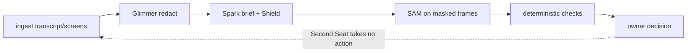

Pre-existing: the Second Seat idea and an earlier prototype in a separate repo (not included). Built this week (Oct 26–Nov 4): everything in this repo.

# Second Seat

## What it is

Second Seat is a text-input meeting decision assistant: I paste in meeting text, Glimmer redacts the PII, I review the redacted text, and Spark writes a short brief with citations: what was offered, what was asked, what needs a decision. Pressure items are held for review. I edit a reply and copy it out myself. Second Seat never sends a reply to the vendor. It never joins calls. It takes no action. Shield flags drafts that match the commitment checks we test. Commitment checks are advisory, and copying a draft requires my explicit approval of that exact text. I decide. That is the whole deal.

## Why it matters

TARGET figures only: none yet. I have not written down my time-per-call or risk numbers. Until I do, there is nothing here but a TARGET label and me telling you vendors talk fast on purpose.

## Agent loop



I am the only one who acts. The loop ends at me.

## Models

| Model | Job | Settings |
|---|---|---|
| muse-spark-1.3 | brief | reasoning medium, seed 42, max tokens 16000, strict JSON schema [eval/results/prompt-freeze.md] |
| muse-spark-1.3 | Shield classifier | reasoning low [eval/results/prompt-freeze.md] |
| muse-spark-1.3 | support judge | reasoning medium [eval/results/prompt-freeze.md] |
| sam-3.1 | vision regions (experimental, outside the core flow, off by default) | masked frames only [eval/results/prompt-freeze.md] |
| Muse Glimmer 30B | redact PII | self-hosted vLLM on Modal; recall 10/10 on n=10 [services/bot/fixtures/glimmer-live-eval-n10.json] |

Image/SAM features (sam-3.1, muse-image-1.0) are experimental, outside the text-only core flow, and off by default (live calls require SECOND_SEAT_EXPERIMENTAL_IMAGES=1). No Muse Image row. The hero-chain fixtures do not show it, so it does not go here. A longer Glimmer run was invalid due to a reply-parsing bug. Fixed. Not yet re-run. (No count given: no committed file states it, so I am not printing one.)

Redact sampling: temperature 1.0, top_p 0.95 [eval/results/prompt-freeze.md]. Yes, that is warm for a redactor. It is on my list.

## Results

Brief scores. Hero (recorded brief scored against synthetic truth): 9 brief entries against 12 truth entries, 8 citations resolved, 11 truth entry match, 8 category agreement [eval/results/hero-brief-score.json]. Metrics: truth entry match = matched truth entries / total truth entries; citations resolved = brief entries with no citation_not_found and no missing_source / total brief entries. Dev meetings (live): 10/10 validator-clean, recall 13/16, category agreement 9/13, total cost estimated $0.0547 [eval/results/dev-briefs.md]. Per meeting: dev01 recall 4/5 at estimated $0.0212 [eval/results/dev01-brief-score.json], dev02 recall 4/5 at estimated $0.0159 [eval/results/dev02-brief-score.json], dev03 recall 5/6 at estimated $0.0176 [eval/results/dev03-brief-score.json]. dev04 and dev05 were not scored (3-call cap) [eval/results/dev-briefs.md].

Seeded-error suite. Fixture judge (synthetic): caught 9/9, Wilson 95% CI [0.701, 1], false alarms 0/4, CI [0, 0.49] [eval/results/support-score.json]. Live frozen run (recorded): same 9/9 catch and 0/4 false alarms with the same CIs [eval/results/support-score-frozen-live.json], but 2 cases mismatched exact grade (F4, M3) [eval/results/support-table-frozen-live.md]. So it catches everything and quibbles twice. Baseline with the judge off (synthetic) catches 0/9, CI [0, 0.299] [eval/results/support-table.md]. Good. That means the judge is doing the work.

Load and prompt freeze (mock). Fixture mode only, localhost, says nothing about production [eval/results/load-fixture.md]. HTTP GET x500 at concurrency 20: 0 failed, p50 106.6ms, p90 116.3ms, max 1245ms [eval/results/load-fixture.json]. Brief CLI x20: 0 failed, p50 1.4ms, p90 4.2ms, max 8.9ms [eval/results/load-fixture.json]. Prompts pinned by sha256 [eval/results/prompt-freeze.md].

Glimmer (live): 10/10 legacy entity disappearance, 12 spans returned for 10 expected entities, no misses [services/bot/fixtures/glimmer-live-eval-n10.json]. Metrics: legacy_entity_disappearance = entities absent from masked text (completed cases vs end-to-end over the planned batch); span coverage requires every character of a span masked; char coverage = masked PII chars / total PII chars; over_redaction_rate = masked non-PII chars / total non-PII chars; request completion = completed/planned requests, completed recall vs end-to-end recall. Rescore of the recorded glimmer-run batch: requests 6/8, legacy entity disappearance 18/29 on completed, 18/39 end-to-end; span coverage / over-redaction not re-scorable (predictions not keyed to cases) [services/bot/fixtures/glimmer-run/rescore.json]. That's the older Oct 26 run. The latest 39-item attempt (Oct 26, 4:21 PM CDT) was incomplete: 6/8 cases completed, 18/29 recall on completed cases, 18/39 on the full batch, so it is not a valid score [services/bot/fixtures/glimmer-run/glimmer-live-eval.json].

Tests: 163 passing (core 62, bot 49, web 28, eval 24) from `pnpm -r test` on Oct 26. CI runs typecheck, unit tests, hash check, secret scan; Playwright (12 tests) is run locally.

## Ground truth

Sealed before generation (synthetic) + AMI human annotations (third party). The synthetic meetings are labeled synthetic, written Oct 26, no real people [eval/truth/DATA.md]. AMI mapping rules and license (CC BY 4.0) are recorded before any run [eval/truth/ami-mapping-rules.md]. AMI run: planned, not yet run. Sealed held-out brief run: seal PENDING, not run [eval/heldout-presealed.sha256].

## Known gaps

From my failure-modes list [docs/failure-modes.md], short version. If SAM finds nothing, we return a full-frame box flagged for spot-check. If Spark throws 429/5xx, we retry up to 4 times, then throw. No fallback to fixtures. That fallback is not implemented, on purpose for now. If spend hits the $5/day cap or the daily call count, we refuse the call outright. No partial calls. Glimmer redaction carries a 180 s timeout and a 2048 max-tokens default, and a failed eval case counts its entities as misses.

## Built with

Built with Muse Code (Meta's coding agent) as the build agent. Grok Bot drove and verified. I supervised and take the blame.

## How to run

Fixture mode is the default. No network. No model calls.

```sh
pnpm install
pnpm -r build
pnpm -r test
```

Root test script runs `pnpm -r test` [package.json].
