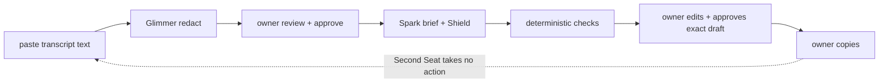

Pre-existing: the Second Seat idea and an earlier prototype in a separate repo (not included). Built this week (Oct 26–Nov 4): everything in this repo.

# Second Seat

## What it is

Second Seat is a text-input meeting decision assistant. The connected workflow, in one session on `/session` (`apps/web`, PRs A4–A8), is: I paste meeting text, the redaction step masks PII for my review, I review and correct the redacted text, I approve it, the brief step writes a short brief with citations (what was offered, what was asked, what needs a decision), I edit the reply draft, I approve that exact text, and I copy it out myself. `#btn-copy` stays disabled until I approve the exact current draft text and finish pressure review of every item; it only writes that text to my clipboard; any edit to the draft or transcript clears the approval. Second Seat sends nothing. Second Seat never sends a reply to the vendor. It never joins calls. It takes no action. Shield flags drafts that match the commitment checks we test. Commitment checks are advisory, and copying a draft requires my explicit approval of that exact text. I decide. That is the whole deal.

## Demo modes: offline, recorded, live

- Offline (default): `SECOND_SEAT_MODE` unset means offline analysis; `SECOND_SEAT_TEST_MODE=1` forces offline even when provider credentials are present, so credentials alone can never enable model calls (`apps/web/src/liveConfig.ts`). Fixture mode is the default. No network. No model calls. The redaction and brief are produced by deterministic offline code (pattern masking and fixture analysis), not by Glimmer or Spark.
- Recorded: the demo replays precomputed analysis from logged runs (see Results). The video labels every replay as a replay.
- Live (not performed): live mode requires `SECOND_SEAT_MODE=live` plus `GLIMMER_BASE_URL` plus `META_API_KEY` (`apps/web/src/liveConfig.ts`). The live adapter path was tested only with fake transports. No live model execution was performed for the new live path. In live mode the approved text is sent to the Glimmer endpoint on Modal (remote GPU).

Offline, pressure is detected by the offline pattern layer (detectPressurePatterns); each item quotes a substring of a cited current segment. In live mode no pressure classifier is wired by default.

## Statuses

| PR | Implementation | Offline verification | Live verification | Partner verification |
|---|---|---|---|---|
| A1 | merged (#35) | offline verified | live not performed | none |
| A2 | merged (#36) | offline verified | live not performed | none |
| A3 | merged (#37) | offline verified | live not performed | none |
| A4 | merged (#38) | offline verified | live not performed | none |
| A5 | merged (#39) | offline verified | live not performed | none |
| A6 | merged (#40) | offline verified | live not performed | none |
| A7 | merged (#41) | offline verified | live not performed | none |
| A8 | merged (#42) | offline verified | live not performed | none |
| A9 | merged (#43) | offline verified | live not performed | none |
| B1 | draft PR (#44) | offline tests pass | live not performed | none |
| B2 | draft PR (#45) | offline tests pass | live not performed | none |
| B3 | draft PR (#48) | offline tests pass | live not performed | none |
| B4 | draft PR (#46) | offline tests pass | live not performed | none |
| B5 | draft PR (#47) | offline tests pass | live not performed | none |
| B6 | draft PR (#49) | offline tests pass | live not performed | none |
| B7 | this draft PR (docs) | docs checks pass | live not performed | none |
| B8 | draft (evidence protocol only; no observations) | no observations | live not performed | none |

## Why it matters

TARGET figures only: none yet. I have not written down my time-per-call or risk numbers. Until I do, there is nothing here but a TARGET label and me telling you vendors talk fast on purpose.

Founder story: PENDING — not yet supplied. User observations: PENDING — not yet supplied. Video URLs: PENDING — not yet supplied.

## Agent loop



I am the only one who acts. The loop ends at me. Image/SAM features are experimental, outside this text-only core flow, and off by default (live calls require `SECOND_SEAT_EXPERIMENTAL_IMAGES=1`); they appear in no step above and not in the core video.

## Models

| Model | Job | Settings |
|---|---|---|
| meta-models/Muse-Glimmer-30B | redact PII | self-hosted vLLM on Modal (remote GPU); `GLIMMER_MODEL` in [services/bot/src/private/redact.ts] |
| muse-spark-1.3 | brief | reasoning medium, seed 42, max tokens 16000, strict JSON schema [eval/results/prompt-freeze.md]; `BRIEF_MODEL` in [services/bot/src/brief/muse.ts] |
| muse-spark-1.3 | Shield classifier | reasoning low [eval/results/prompt-freeze.md] |
| muse-spark-1.3 | support judge | reasoning medium [eval/results/prompt-freeze.md] |

Redact sampling: temperature 1.0, top_p 0.95 [eval/results/prompt-freeze.md]. Yes, that is warm for a redactor. It is on my list.

## Results

Brief scores. Hero (recorded brief scored against synthetic truth): 9 brief entries against 12 truth entries, 8 citations resolved, 11 truth entry match, 8 category agreement [eval/results/hero-brief-score.json]. Metrics: truth entry match = matched truth entries / total truth entries; citations resolved = brief entries with no citation_not_found and no missing_source / total brief entries. Dev meetings (live): 10/10 validator-clean, recall 13/16, category agreement 9/13, total cost estimated $0.0547 [eval/results/dev-briefs.md]. Per meeting: dev01 recall 4/5 at estimated $0.0212 [eval/results/dev01-brief-score.json], dev02 recall 4/5 at estimated $0.0159 [eval/results/dev02-brief-score.json], dev03 recall 5/6 at estimated $0.0176 [eval/results/dev03-brief-score.json]. dev04 and dev05 were not scored (3-call cap) [eval/results/dev-briefs.md].

Seeded-error suite. Fixture judge (synthetic): caught 9/9, Wilson 95% CI [0.701, 1], false alarms 0/4, CI [0, 0.49] [eval/results/support-score.json]. Live frozen run (recorded): same 9/9 catch and 0/4 false alarms with the same CIs [eval/results/support-score-frozen-live.json], but 2 cases mismatched exact grade (F4, M3) [eval/results/support-table-frozen-live.md]. Baseline with the judge off (synthetic) catches 0/9, CI [0, 0.299] [eval/results/support-table.md]. Small samples throughout; the judge results describe these cases only.

Load and prompt freeze (mock). Fixture mode only, localhost, says nothing about production [eval/results/load-fixture.md]. HTTP GET x500 at concurrency 20: 0 failed, p50 106.6ms, p90 116.3ms, max 1245ms [eval/results/load-fixture.json]. Brief CLI x20: 0 failed, p50 1.4ms, p90 4.2ms, max 8.9ms [eval/results/load-fixture.json]. Prompts pinned by sha256 [eval/results/prompt-freeze.md].

Glimmer redaction, historical run (Oct 26, recorded, incomplete — shown with its limitations, not as a headline score): requests 6/8 completed, legacy entity disappearance 18/29 on completed cases and 18/39 end-to-end over the planned batch, `complete: false`; span coverage and over-redaction are not re-scorable because predictions were not keyed to case files [services/bot/fixtures/glimmer-run/rescore.json] [services/bot/fixtures/glimmer-run/eval-summary.json]. The two failures were a reply-parsing error (invalid JSON) and a length finish with empty output [services/bot/fixtures/glimmer-run/rescore.json]. A separate n=10 run scored 10/10 legacy entity disappearance [services/bot/fixtures/glimmer-live-eval-n10.json]; that is a small smoke test and is not the headline. Metrics: legacy_entity_disappearance = entities absent from masked text (completed cases vs end-to-end over the planned batch); span coverage requires every character of a span masked; char coverage = masked PII chars / total PII chars; over_redaction_rate = masked non-PII chars / total non-PII chars; request completion = completed/planned requests.

Tests at commit [2477d2e](https://github.com/Bridgett50/second-seat-hackathon/commit/2477d2ec82202b535a8bef13fbdaa97e05a647ba) (B6 head): `pnpm -r test` gives core 65, eval 24, bot 200, web 130. Playwright 41 tests; CI run https://github.com/Bridgett50/second-seat-hackathon/actions/runs/40464552140 .

## Ground truth

Sealed before generation (synthetic) + AMI human annotations (third party). The synthetic meetings are labeled synthetic, written Oct 26, no real people [eval/truth/DATA.md]. AMI mapping rules and license (CC BY 4.0) are recorded before any run [eval/truth/ami-mapping-rules.md]. AMI run: planned, not yet run. Sealed held-out brief run: seal PENDING, not run [eval/heldout-presealed.sha256].

## Known gaps

From my failure-modes list [docs/failure-modes.md], short version. If SAM finds nothing, we return a full-frame box flagged for spot-check. If Spark throws 429/5xx, we retry up to 4 times, then throw. No fallback to fixtures. That fallback is not implemented, on purpose for now. If spend estimates reach the $5/day cap or the daily call count (default 50 calls/day), `services/bot/src/brief/costGuard.ts` refuses the call outright. No partial calls. This is based on estimated cost, not a hard billing guarantee — provider billing is not controlled by this code. Glimmer redaction carries a 90 s per-request timeout default (`glimmerTimeoutMs` in [services/bot/src/private/redact.ts]) and a 2048 max-tokens default, and a failed eval case counts its entities as misses. The holdout run budget covers the full Modal allocation: 780 s work deadline and 840 s function timeout, plus container startup, model load, ready wait, and teardown [docs/runbook-holdout-run.md] [infra/modal/glimmer_app.py].

On privacy, what the code does and what is tested: the session flow sends the approved redacted text through the privacy gate, and test mode stays offline even with credentials present [apps/web/src/liveConfig.ts]. That is a code behavior with fake-transport tests, not a guarantee that no raw transcript can ever leave.

## Built with

Built with Muse Code (Meta's coding agent) as the build agent. Grok Bot drove and verified. I supervised and take the blame.

## How to run

Fixture mode is the default. No network. No model calls.

```sh
pnpm install
pnpm -r build
pnpm -r test
```

Start the offline demo (keeps running; Ctrl-C to stop)

```sh
SECOND_SEAT_TEST_MODE=1 pnpm --filter @second-seat/web serve
```

Then open http://localhost:4173/session (the server log line prints /briefs/demo; the connected flow is /session). Verified offline: GET /session returned 200 with the "Offline demo" label.

Root test script runs `pnpm -r test` [package.json].
