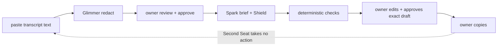

Pre-existing: the Second Seat idea and an earlier prototype in a separate repo (not included). Built this week (Oct 26–Nov 4): everything in this repo.

# Second Seat

## What it is

Second Seat is a text-input meeting decision assistant. The connected workflow, in one session on `/session` (`apps/web`, PRs A4–A8), is: I paste meeting text, the redaction step masks PII for my review, I review and correct the redacted text, I approve it, the brief step writes a short brief with citations (what was offered, what was asked, what needs a decision), I edit the reply draft, I approve that exact text, and I copy it out myself. `#btn-copy` stays disabled until I approve the exact current draft text and finish pressure review of every item; approval requires an explicit click on `#btn-draft-approve`; it only writes that text to my clipboard; edits in the open page clear the approval, but a reload after an A->B->A edit during a held approval can still show Copy enabled (open; F4 partly open, approveDraft does not revoke on input). Second Seat never sends a reply or message to the vendor; I copy the approved draft myself. It never joins calls. It takes no action. Shield flags drafts that match the commitment checks we test. Commitment checks are advisory, and copying a draft requires my explicit approval of that exact text. I decide. That is the whole deal.

## Demo modes: offline, recorded, live

- Offline (default): `SECOND_SEAT_MODE` unset means offline analysis; `SECOND_SEAT_TEST_MODE=1` forces offline even when provider credentials are present, so credentials alone can never enable model calls (`apps/web/src/liveConfig.ts`). Fixture mode is the default. No network. No model calls. The redaction and brief are produced by deterministic offline code (pattern masking and fixture analysis), not by Glimmer or Spark.
- Recorded: the demo replays precomputed analysis from logged runs (see Results). The video labels every replay as a replay.
- Live: live mode requires `SECOND_SEAT_MODE=live` plus `GLIMMER_BASE_URL` plus `META_API_KEY` (`apps/web/src/liveConfig.ts`). Live end-to-end passed 3/3 on Oct 28, 2026 at main `0365fdb`. Rehearsals passed at `8c00c32` and on the November 15 prompt fix (#116); that fix was not a new live model call. In live mode, raw pasted meeting text goes to the private Glimmer redactor (self-hosted vLLM on Modal, remote GPU) for redaction. Only the owner-reviewed, approved redacted text goes to Spark (muse-spark-1.3) for analysis. Second Seat never sends a reply or message to the vendor; I copy the approved draft myself. The public link is demo mode with recorded examples. The Oct 28 live run was recorded and is labeled as a recorded run.

The deterministic pattern layer runs by default in both offline and live modes and surfaces pressure items under the source label "deterministic pattern detection"; each item quotes a substring of a current segment. Each item carries a status of `not_run`, `failed`, `valid_negative`, or `valid_positive`; not run and failed items are shown explicitly and block Copy until resolved. The unresolved term is shown only when it is a verbatim substring of the cited segment (not the whole segment), else the item shows "term not identified". In live mode the structured assessment is carried inside the single Spark analysis request. Every pressure item must be reviewed before Copy.

The status table below is the per-PR ledger from when those PRs were tested. A cell that says live not performed describes that head, not the later Oct 28 session. Since then, verification is wired into the session (#113). The Shield report (#114) and the resistance table (#115) run on dev fixtures. The sealed held-out run is scheduled for Nov 2 and is not opened by this note. Video URL, founder story, and user observations stay pending in the section below.

## Statuses

| PR | Implementation | Offline verification | Live verification | Partner verification |
|---|---|---|---|---|
| A1 | merged (#35) | criteria reconstructed from merged PR #35 (not verbatim); offline tests pass | live not performed | none |
| A2 | merged (#36) | criteria reconstructed from merged PR #36 (not verbatim); offline tests pass | live not performed | none |
| A3 | merged (#37) | criteria reconstructed from merged PR #37 (not verbatim); offline tests pass | live not performed | none |
| A4 | merged (#38) | reconstructed; not re-verified at restacked heads; offline tests pass | live not performed | none |
| A5 | merged (#39) | reconstructed; not re-verified at restacked heads; offline tests pass | live not performed | none |
| A6 | merged (#40) | reconstructed; not re-verified at restacked heads; offline tests pass | live not performed | none |
| A7 | merged (#41) | reconstructed; not re-verified at restacked heads; offline tests pass | live not performed | none |
| A8 | merged (#42) | reconstructed; not re-verified at restacked heads; offline tests pass | live not performed | none |
| A9 | merged (#43) | reconstructed; not re-verified at restacked heads; offline tests pass | live not performed | none |
| B1 | draft PR (#44) | offline tests pass | live not performed | none |
| B2 | draft PR (#45) | offline tests pass | live not performed | none |
| B3 | draft PR (#48) | offline tests pass | live not performed | none |
| B4 | draft PR (#46) | offline tests pass | live not performed | none |
| B5 | draft PR (#47) | offline tests pass | live not performed | none |
| B6 | draft PR (#49) | offline tests pass | live not performed | none |
| B7 | this draft PR (docs) | docs checks pass | live not performed | none |
| B8 | draft (evidence protocol only; no observations) | no observations | live not performed | none |
| C1 | draft PR (#54) | criteria C1-1..C1-9 (C1-9 pending D2-6); tested commit https://github.com/Bridgett50/second-seat-hackathon/commit/077c7d35d1fa7fd8a967f179187e137fb45831b5; CI https://github.com/Bridgett50/second-seat-hackathon/actions/runs/40479067260 success (historical CI: run head 8d1ca97, success; not the tested commit) | live not performed | none |
| C2 | draft PR (#55) | criteria C2-1..C2-7 (C2-7 pending); tested commit https://github.com/Bridgett50/second-seat-hackathon/commit/b63c1cf28a6973cfea1ef6cd827164553aa36e5d; CI https://github.com/Bridgett50/second-seat-hackathon/actions/runs/40479898486 success (historical CI: run head 2617b79, success; not the tested commit) | live not performed | none |
| C3 | draft PR (#56) | criteria C3-1..C3-8 (C3-7/C3-8 pending); tested commit https://github.com/Bridgett50/second-seat-hackathon/commit/de50552b66c25f5c920dff50b2d5252782ec2c39; CI https://github.com/Bridgett50/second-seat-hackathon/actions/runs/40480594570 (historical CI: run head fb4c216, failure; not the tested commit) failed at the pre-restack commit (web build emitted to dist/apps/web); old build failure fixed at de50552 (F6 closed) | live not performed | none |
| C4 | draft PR (#57) | criteria C4-1..C4-11 (C4-7/C4-8/C4-9/C4-11 pending D5); tested commit https://github.com/Bridgett50/second-seat-hackathon/commit/1f4b74f1ece34fcaeb4a8fdee7696f6a4095040a; CI https://github.com/Bridgett50/second-seat-hackathon/actions/runs/40484194423 (historical CI: run head b383e12, failure; not the tested commit) failed at the pre-restack commit (same build issue); old build failure fixed at de50552 (F6 closed) | live not performed | none |
| C5 | draft PR (#58) | criteria C5-1..C5-12 (C5-3/C5-6 partial); tested commit https://github.com/Bridgett50/second-seat-hackathon/commit/9a3dd34e41f6d7654c9ff5b93eae175ff31a54d8; CI https://github.com/Bridgett50/second-seat-hackathon/actions/runs/40484954956 (historical CI: run head 789ab3c, failure; not the tested commit) failed at the pre-restack commit (same build issue); old build failure fixed at de50552 (F6 closed) | live not performed | none |
| C6 | draft PR (#53) | criteria C6-1..C6-7 (C6-4/C6-7 pending D3); tested commit https://github.com/Bridgett50/second-seat-hackathon/commit/7af1d4b077a68d4063546fc94553bb73aa271397; CI https://github.com/Bridgett50/second-seat-hackathon/actions/runs/40477442184 success (historical CI: run head 7efcae0, success; not the tested commit) | live not performed | none |
| C7 | draft PR (#59) | criteria C7-1..C7-8 (C7-2/C7-3/C7-7/C7-8 partial); tested commit https://github.com/Bridgett50/second-seat-hackathon/commit/7442f77538494fd35e0778d104e19aca694fc5d5; CI https://github.com/Bridgett50/second-seat-hackathon/actions/runs/40486174227 success (historical CI: run head 1153dd8, success; not the tested commit) | live not performed | none |
| C8 | docs | criteria C8-1..C8-9; tested commit https://github.com/Bridgett50/second-seat-hackathon/commit/d1cd7e1e6814933ead71cbd9750b5cb9a2714f28; prose checks pass | live not performed | none |
| C9 | prep only | criteria C9-P1..C9-P10; tested commit https://github.com/Bridgett50/second-seat-hackathon/commit/dd7c8c69244872f04515d1a20b07a2625b6dcddb; execution blocked | live not performed | none |
| D1 | this repo | criteria D1-1..D1-5 (review verdicts: D1-1 partly, D1-2 closed, D1-3 closed, D1-4 closed, D1-5 closed); tested head a23b46295c302113a294713adace48d10f97030a; fake-transport/fixture tests | live not performed | none |
| D2 | this repo | criteria D2-1..D2-6 (review verdicts: D2-1 closed, D2-2 partly, D2-3 closed, D2-4 closed, D2-5 closed, D2-6 partly); tested head 9d5dd7fc700c2e76c2f1375bc10dd593b4cb07b1; probe apps/web/e2e/d2-approval.spec.ts with fake transport | live not performed | none |
| D3 | this repo | criteria D3-1..D3-5 (review verdicts: D3-1 closed, D3-2 partly, D3-3 partly, D3-4 open, D3-5 partly); tested head 7af1d4b077a68d4063546fc94553bb73aa271397; fake-repo tests | live not performed | none |
| D4 | this repo | criteria D4-1..D4-6 (review verdicts: D4-1 closed, D4-2 partly, D4-3 partly, D4-4 open, D4-5 closed, D4-6 partly); tested head b1ba5dbd50689fe6aec5716fd509cbc5b3426dfe; inert-stub tests | live not performed | none |
| D5 | this repo | criteria D5-1..D5-5 (review verdicts: D5-1 partly, D5-2 closed, D5-3 partly, D5-4 partly, D5-5 partly); tested head 6b37061ee2d1726077961e1ac077de20e954a02c; dummy-bundle tests | live not performed | none |
| D6 | this change (docs) | criteria D6-1..D6-5 (review verdicts: D6-1 closed, D6-2 open, D6-3 closed, D6-4 open, D6-5 closed); tested head 1d19da07260166909d4f7d21ee82f9576923fb64; file checks only | live not performed | none |

### Ledger corrections (E6) and current limitations

Current limitations match [docs/codex/cursor-D-review.md](docs/codex/cursor-D-review.md): F4 partly open (in the open page an A->B->A edit keeps Copy disabled, but a reload after an A->B->A edit during a held approval can still show Copy enabled because approveDraft does not revoke on input; a fix is in draft PR E7 (#73, unmerged, unreviewed) pending review/merge: editing while a draft is approved or an approval is in flight revokes server approval immediately, so a reload after an A->B->A edit keeps Copy disabled, tested fail-before/pass-after by apps/web/e2e/e3-reload.spec.ts; F4 remains partly open on the reviewed baseline until review and merge); F5 closed; F6 closed (old build failure fixed at de50552).

Superseded wording (no longer claimed): "any edit to the draft or transcript clears the approval" — replaced by the open-page plus reload-caveat statement above.

### E-series fixes (draft, unmerged)

Draft PRs with fail-before/pass-after tests: E1 (D1-1/F1), E2 (D4-4/D4-6/F7), E3 (F4 reload) fixed in draft E7 (#73, unmerged, unreviewed) pending review/merge (tested fail-before/pass-after by apps/web/e2e/e3-reload.spec.ts), E4 (D5-1/D5-2/D5-3/F8), E5 (D3-2/D3-4/F9), E8 (D4-3) in draft PR (#74, unmerged, unreviewed) pending review/merge binding launch to git HEAD == source_sha with a clean working tree with changes outside the packaged hash refusing with zero spawns (tested by services/bot/test/e8-gitsha.test.ts). On the reviewed baseline F4 remains partly open and D4-3 remains partly open until review and merge. See [docs/codex/cursor-D-review.md](docs/codex/cursor-D-review.md). Further draft PRs (unmerged, unreviewed): E10 (#76, audit F1) sets Glimmer redaction to temperature 0.0 with no top_p/top_k (reasoning_strength low unchanged) with the empty-answer prompt aligned with the validator; E11 (#77, audit F2) feeds the live SSE events to the official @meta-sam/parser with confidence via metadata.include_confidence, so response.content_part.done (what the live API emits) parses with output_text.delta still accepted, and the default fixture box is 60x27 to match its 27x60 mask (x2/y2 inclusive), while services/bot/scripts/hero-chain.mjs still has its own local parser and no include_confidence (open); E12 (#78, audit F3) sends one stable prompt_cache_key per call family ("second-seat-brief", "second-seat-shield", "second-seat-support") instead of one shared "second-seat" key, and the demo page shows the prompt-cache hit ratio from stored cachedTokens, with the recorded brief showing 0 of 2271 input tokens cached and no cache hit measured (no live call made); E13 (#79, audit F4) made the root AGENTS.md a minimal pointer to .agents/AGENTS.md with no non-public citations, keeping helper guardrails in Muse-Code-protected paths (.agents/AGENTS.md, .muse/guard.sh, .muse/verify_pr.sh); E14 (#80) prompt-freeze also hashes the inline redaction system prompt.

## Why it matters

TARGET figures only: none yet. I have not written down my time-per-call or risk numbers. Until I do, there is nothing here but a TARGET label.

Founder story: PENDING — not yet supplied. User observations: PENDING — not yet supplied. Video URLs: PENDING — not yet supplied.

## Agent loop



I am the only one who acts. The loop ends at me. Image/SAM features are experimental, outside this text-only core flow, and off by default (live calls require `SECOND_SEAT_EXPERIMENTAL_IMAGES=1`); they appear in no step above and not in the core video.

## Models

| Model | Job | Mode / settings |
|---|---|---|
| meta-models/Muse-Glimmer-30B | redact PII | self-hosted vLLM on Modal (remote GPU); `GLIMMER_MODEL` in [services/bot/src/private/redact.ts] |
| muse-spark-1.3 | brief | Standard mode; reasoning medium, seed 42, max tokens 16000, strict JSON schema [eval/results/prompt-freeze.md]; `BRIEF_MODEL` in [services/bot/src/brief/muse.ts] |
| muse-spark-1.3 (standalone/historical path only, not the current session path) | Shield classifier | Standard mode; reasoning low [eval/results/prompt-freeze.md] |
| muse-spark-1.3 | support judge | Standard mode; reasoning medium [eval/results/prompt-freeze.md] |

Model paths, per the official Meta docs: the current session pressure path uses deterministic offline patterns (`apps/web/src/session.ts`), not a model call. The `muse-spark-1.3` Shield classifier is a standalone/historical model path; the live demo is not credited with it. Brief and redactor live verification passed 3/3 on Oct 28, 2026 at `0365fdb`. Contributor mode (`muse-spark-1.3-contributor`) is live not performed; it is not configured anywhere. `muse-spark-1.3` is the Standard-mode ID; the `-contributor` suffix selects Contributor mode. A recursive `json_schema` (a `$ref` cycle) is rejected with HTTP 400; recursive structures must be flattened to fixed depth.

Redact sampling (E10, draft PR #76, unmerged, unreviewed): temperature 0.0 with no top_p/top_k, reasoning_strength low unchanged, following the cookbook structured-output recipe (meta-oss-cookbook/muse-glimmer/recipes/structured-output/README.md, structured_output.py:83); this deliberately departs from meta-oss-cookbook/muse-glimmer/inference-server/vllm.md:112 (which advises against greedy decoding). The system prompt's empty answer is {"spans":[],"boxes":[]} (the shape the validator accepts) plus "never guess". Tested by services/bot/test/e10-redact-temp.test.ts [eval/results/prompt-freeze.md]. Changing decoding and the inline prompt changes the frozen prompt hash and decoding row, so any prepared holdout config must be re-frozen before a launch.

## Results

Brief scores. Hero (recorded brief scored against synthetic truth): 9 brief entries against 12 truth entries, 8 citations resolved, 11 truth entry match, 8 category agreement [eval/results/hero-brief-score.json]. Metrics: truth entry match = matched truth entries / total truth entries; citations resolved = brief entries with no citation_not_found and no missing_source / total brief entries. Dev meetings (live): 10/10 validator-clean, recall 13/16, category agreement 9/13, total cost estimated $0.0547 [eval/results/dev-briefs.md]. Per meeting: dev01 recall 4/5 at estimated $0.0212 [eval/results/dev01-brief-score.json], dev02 recall 4/5 at estimated $0.0159 [eval/results/dev02-brief-score.json], dev03 recall 5/6 at estimated $0.0176 [eval/results/dev03-brief-score.json]. dev04 and dev05 were not scored (3-call cap) [eval/results/dev-briefs.md].

Seeded-error suite. Fixture judge (synthetic): caught 9/9, Wilson 95% CI [0.701, 1], false alarms 0/4, CI [0, 0.49] [eval/results/support-score.json]. Live frozen run (recorded): same 9/9 catch and 0/4 false alarms with the same CIs [eval/results/support-score-frozen-live.json], but 2 cases mismatched exact grade (F4, M3) [eval/results/support-table-frozen-live.md]. Baseline with the judge off (synthetic) catches 0/9, CI [0, 0.299] [eval/results/support-table.md]. Small samples throughout; the judge results describe these cases only.

Load and prompt freeze (mock). Fixture mode only, localhost, says nothing about production [eval/results/load-fixture.md]. HTTP GET x500 at concurrency 20: 0 failed, p50 106.6ms, p90 116.3ms, max 1245ms [eval/results/load-fixture.json]. Brief CLI x20: 0 failed, p50 1.4ms, p90 4.2ms, max 8.9ms [eval/results/load-fixture.json]. Prompts pinned by sha256 [eval/results/prompt-freeze.md].

Glimmer redaction, historical run (Oct 26, recorded, incomplete — shown with its limitations, not as a headline score): requests 6/8 completed, legacy entity disappearance 18/29 on completed cases and 18/39 end-to-end over the planned batch, `complete: false`; span coverage and over-redaction are not re-scorable because predictions were not keyed to case files [services/bot/fixtures/glimmer-run/rescore.json] [services/bot/fixtures/glimmer-run/eval-summary.json]. The two failures were a reply-parsing error (invalid JSON) and a length finish with empty output [services/bot/fixtures/glimmer-run/rescore.json]. A separate n=10 run scored 10/10 legacy entity disappearance [services/bot/fixtures/glimmer-live-eval-n10.json]; that is a small smoke test and is not the headline. Metrics: legacy_entity_disappearance = entities absent from masked text (completed cases vs end-to-end over the planned batch); span coverage requires every character of a span masked; char coverage = masked PII chars / total PII chars; over_redaction_rate = masked non-PII chars / total non-PII chars; request completion = completed/planned requests.

Tests at commit [2477d2e](https://github.com/Bridgett50/second-seat-hackathon/commit/2477d2ec82202b535a8bef13fbdaa97e05a647ba) (B6 head): `pnpm -r test` gives core 65, eval 24, bot 200, web 130. Playwright 41 tests; CI run https://github.com/Bridgett50/second-seat-hackathon/actions/runs/40464552140 .

## Ground truth

Sealed before generation (synthetic) + AMI human annotations (third party). The synthetic meetings are labeled synthetic, written Oct 26, no real people [eval/truth/DATA.md]. AMI mapping rules and license (CC BY 4.0) are recorded before any run [eval/truth/ami-mapping-rules.md]. AMI run: planned, not yet run. The sealed held-out run is scheduled for Nov 2 and has not been opened for this note [eval/heldout-presealed.sha256].

## Known gaps

From my failure-modes list [docs/failure-modes.md], short version. If SAM finds nothing, we return a full-frame box flagged for spot-check. If Spark throws 429/5xx, we retry up to 4 times, then throw. No fallback to fixtures. That fallback is not implemented, on purpose for now. If spend estimates reach the $5/day cap or the daily call count (default 50 calls/day), `services/bot/src/brief/costGuard.ts` refuses the call outright. No partial calls. This is based on estimated cost, not a hard billing guarantee — provider billing is not controlled by this code. Glimmer redaction carries a 90 s per-request timeout default (`glimmerTimeoutMs` in [services/bot/src/private/redact.ts]) and a 2048 max-tokens default, and a failed eval case counts its entities as misses. The 780 s work deadline and 840 s function timeout bound the work; the billed allocation also includes container startup, model load, ready wait and teardown and is not capped by this code [docs/runbook-holdout-run.md] [infra/modal/glimmer_app.py].

On privacy, what the code does and what is tested: the session flow sends the approved redacted text through the privacy gate, and test mode stays offline even with credentials present [apps/web/src/liveConfig.ts]. That is a code behavior with fake-transport tests, not a guarantee that no raw transcript can ever leave.

## Built with

Built with Muse Code (Meta's coding agent) as the build agent. Grok Bot drove and verified. I supervised and take the blame.

## How to run

Fixture mode is the default. No network. No model calls.

```sh
pnpm install
pnpm -r build
pnpm -r test
```

Start the offline demo (keeps running; Ctrl-C to stop)

```sh
SECOND_SEAT_TEST_MODE=1 pnpm --filter @second-seat/web serve
```

Then open http://localhost:4173/session (the server log line prints /briefs/demo; the connected flow is /session). Verified offline: GET /session returned 200 with the "Offline demo" label.

Root test script runs `pnpm -r test` [package.json].

---

Moved from README.md for release/v1 (Oct 27, 2026): this file is the full PR ledger and engineering log, kept verbatim. The README is now the short project overview.
